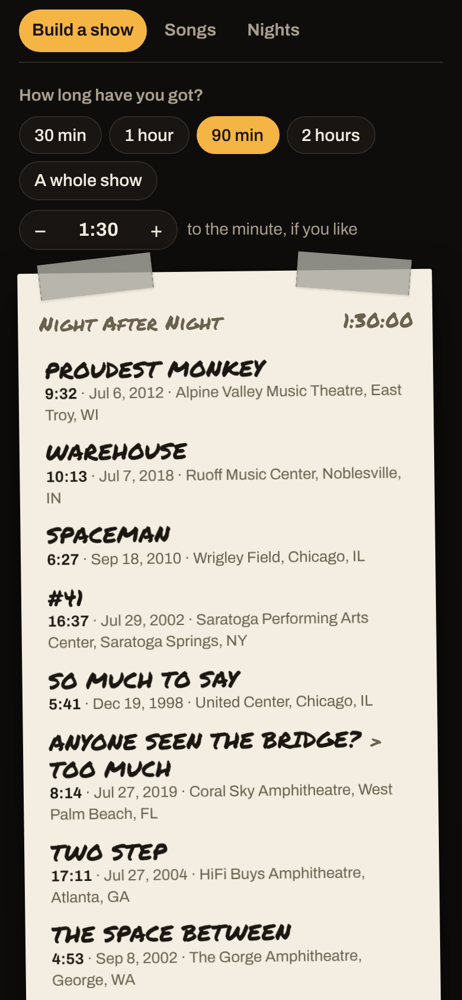
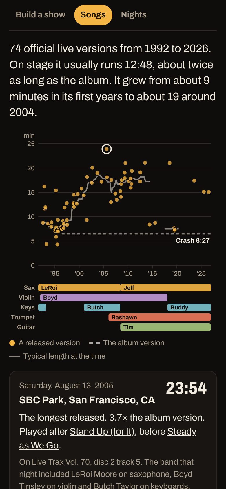
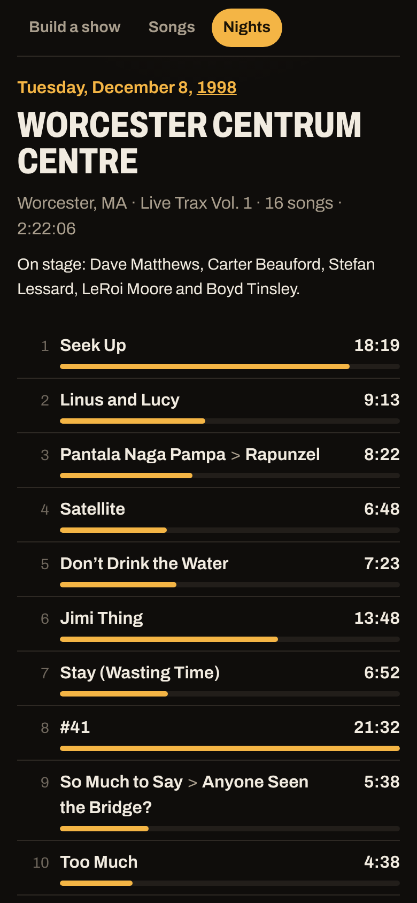
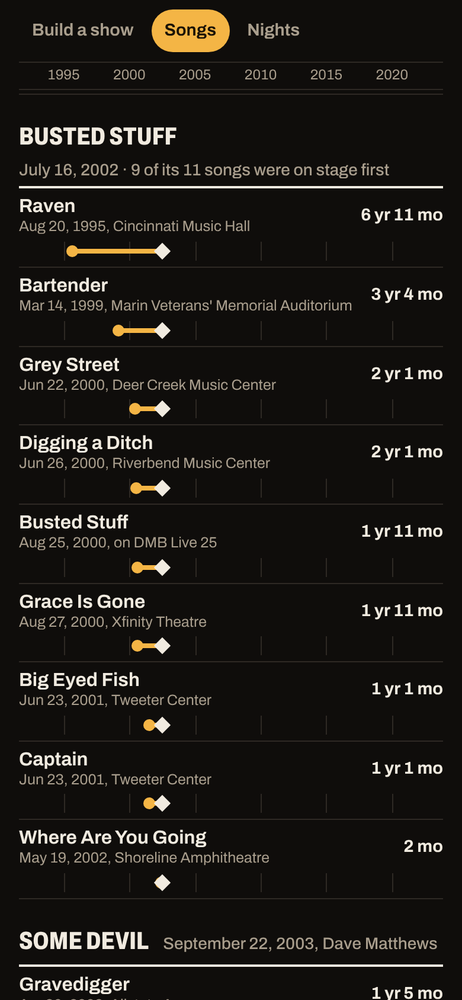
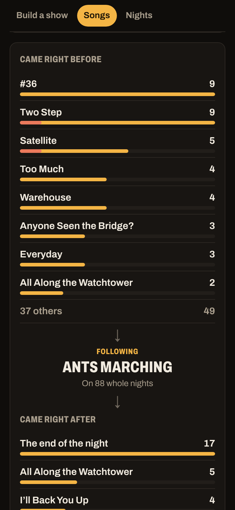
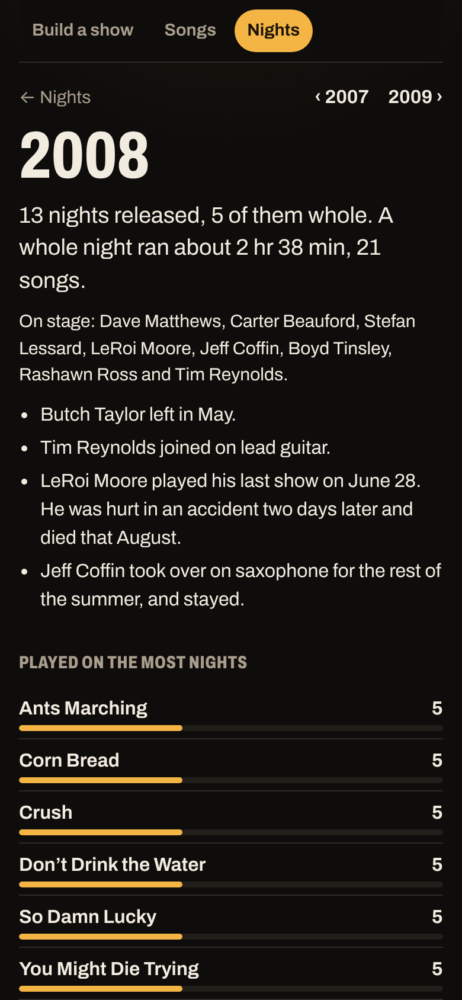

# Night After Night

**Use it: [junkdrawer.works/night-after-night](https://junkdrawer.works/night-after-night/)**

**Every song Dave Matthews Band has released from the stage, and how each one changed from 1992 to now.** Pick a song and every official live version is on a timeline: how long it ran each night against the album version, with the band's lineup underneath, so you can watch Two Step grow from nine minutes to nineteen. Or tell it how long you've got and it writes you a show from those recordings, each song from a real night, in an order learned from how the band actually sequences its sets, landing within seconds of your time.

<p align="center">
  
  &nbsp;
  
  &nbsp;
  
</p>

Step back from one song or one night and the same recordings say more: which songs were on stage years before their album, what the band plays into and out of each song, and what each year on the road looked like.

<p align="center">
  
  &nbsp;
  
  &nbsp;
  
</p>

## How it works

- **Build a show.** Pick 30 minutes, an hour, a whole show, or any length to the five minutes. Narrow it to a decade, the LeRoi Moore years, or one venue (the Gorge, Alpine Valley, SPAC…), lean towards the big ones or the deep cuts, short versions or long jams. It picks the songs, then the versions, then shuffles versions until the total lands within a few seconds of what you asked for.
- **In a believable order.** The opener is something that tends to open (Seek Up, One Sweet World, The Stone), the last song something that tends to close (All Along the Watchtower, Ants Marching, Two Step), and in between each song tends to be followed by what follows it on the band's own nights. Pantala Naga Pampa never turns up without what it led into.
- **Tap a song on the setlist** to swap in another night's version, a different song of about the same length, or take it out. Copy the list, share it as a link, or keep it on the phone. Each song links to a Spotify or Apple Music search for its release.
- **Songs.** Every song with a little picture of its versions over the years. Sort by how often it's been released, how long it runs, or how much longer than the album it got. Each song's page has the timeline, its typical length with each version of the band, what it opens and closes, what it's usually followed by, the bits of other songs heard inside it, and every version.
- **Nights.** Every night with an official release, by year, from Trax in Charlottesville in 1992 to this summer. Each night has its setlist with the length of every song, who was on stage, and the other nights at that venue.
- **Before the album.** More than fifty songs the band was playing live before the album they're on came out, each a line from its earliest released live version to the album's release day: Bartender and Grey Street years ahead of Busted Stuff, Break Free nearly seventeen years ahead of Walk Around the Moon. Below them, the songs that have never been on a studio album.
- **What leads where.** For any song, what the band played right before it and right after it on the nights released whole, and how often it ran straight through without a break. On a wide screen it's a map with the song in the middle; tap a song to follow the thread through a night. Also the pairs the band keeps together (Pantala Naga Pampa into Rapunzel 40 times out of 44), the runs of three it plays most, and the likeliest night: start at the top and keep playing whatever most often came next.
- **A page for each year.** A chart at the top of Nights shows how many nights were released from each year and how long a whole night ran. Each year's page has the albums out that year, who was on stage and who joined or left, the songs played on the most nights, how the nights began and ended, the songs first released that year, and the longest versions.
- No account and no server. Kept shows and your choices stay in your browser. It works offline and installs to a phone's home screen.

## The data

Every recording comes from [MusicBrainz](https://musicbrainz.org/artist/07e748f1-075e-428d-85dc-ce3be434e906), whose data is public domain: all of the band's official releases (the Live Trax series, DMBLive, the live albums, Warehouse fan-club discs, SiriusXM broadcasts) with their tracks and lengths, and each recording's date, venue and song. `node tools/musicbrainz.mjs` fetches them and writes `js/data.js`; run it again after a new release appears there (behind a proxy, Node 22 needs `NODE_USE_ENV_PROXY=1`).

- **Dates** come from the recording itself where MusicBrainz has it, then from the disc or release title, read month first as DMB's releases write them. A track that can't be dated is left out.
- **Songs** are matched however a release spells them ("Corn Bread" and "Cornbread", "Rhyme and Reason" and "Rhyme & Reason"), with typos caught by spelling. Intros, jams between songs, solos and the encore break aren't counted as songs, and a track called "Pantala Naga Pampa > Rapunzel" counts for both.
- **The album version** is the studio album the song is on. For songs on Remember Two Things and a later album, it's the later one, since Remember Two Things was partly recorded live. The songs from Dave's Some Devil are measured against that album.
- **The lineup** is from MusicBrainz's member list and Wikipedia: LeRoi Moore's last show was June 28, 2008, and Jeff Coffin played sax from that summer; Boyd Tinsley left in February 2018. Touring players who were on stage every night (Butch Taylor, Rashawn Ross) are included.
- Mistakes in MusicBrainz show up here. A few known ones are fixed in `tools/titles.mjs` (a 1994 show filed under 2004, venues under old or misspelled names); better still, fix them on MusicBrainz and rebuild.

## Running it

It's a static site: plain HTML, CSS and JavaScript modules, with no build step.

```sh
npx serve .                   # or any static file server, then open the printed address
npm install                   # only for the tools below: esbuild and upng-js
npm test                      # the title reader, the show builder and the insights, then the real page in Chromium (needs Playwright)
node tools/musicbrainz.mjs    # refreshes js/data.js from MusicBrainz (--report lists every song and venue)
node tools/screenshots.mjs    # redraws docs/*.png and og.png
node tools/make-icons.mjs     # redraws the PNG icons from icon.svg
npm run build                 # dist/night-after-night.html, the whole thing in one file
```

To put it online with GitHub Pages: **Settings → Pages → Build and deployment → Deploy from a branch**, then pick `main` and `/ (root)`.

### Files

- `js/data.js`: every night, track, song, venue and release, made by `tools/musicbrainz.mjs` (with `tools/titles.mjs`, which reads track titles and dates).
- `js/model.js`: turns the data into songs, nights and versions, with each song's typical lengths and how it changed. `js/lineup.js`: who was in the band when.
- `js/builder.js`: writes a show: the pool of versions, picking songs, landing on the time, the order, and share links.
- `js/insights.js`: the songs that came before their album, each year's numbers, and which songs lead into which. `js/insight-pages.js`: the pages for those, and the years chart.
- `js/chart.js`: a song's timeline with the lineup underneath, and the small one in the song list. `js/app.js`: the other pages. `js/ui.js`: bits of markup they share.
- `fonts/`: Archivo (SIL Open Font License) and Permanent Marker (Apache License 2.0), served from here so nothing loads from elsewhere.
- `sw.js`: keeps a copy for using offline.
- `test/titles.test.mjs` checks the title and date reading on real titles from the releases; `test/builder.test.mjs` checks known nights, that shows land within a minute for every length and choice with no song twice, and that share links round-trip; `test/insights.test.mjs` checks the songs before their album, the pairs and runs, and the years; `test/e2e.mjs` builds, edits, keeps and reopens a show, opens a song and a night, follows songs through Before the album and What leads where, steps through the years, and checks it works offline.
